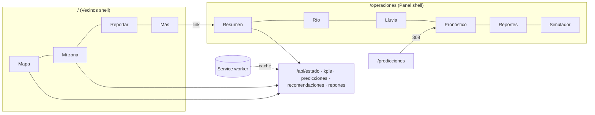

# feat: Cota as an installable app

## Summary

Cota (cota.pegasustudio.com) works but reads as an MVP: three sibling pages behind a pill switcher, the same map-plus-sheet layout everywhere, and no way to install it. This plan turns it into an app while keeping the current visual language (dark glass, little color, white numbers, status as a dot): Vecinos becomes the app itself, Operaciones becomes a sectioned panel that absorbs Predicciones, and the whole thing installs on a phone as a PWA with an offline last reading. Delivery is three stacked PRs agreed with the user. A native Expo app comes later and must reuse the same JSON APIs.

---

## Problem Frame

- The top-level switcher puts Vecinos, Operaciones and Predicciones at the same level, but they serve different people: a neighbour on a phone wants "am I OK, what do I do, report something"; an operator wants every reading, the forecast and the brief in one place.
- Predicciones is a separate route even though only operators read it.
- Operaciones is one long scrolling rail of 10 sections; nothing is reachable directly.
- On a phone it behaves like a website: no install, no full-screen, nothing when the connection drops.

---

## Requirements

- **R1.** Vecinos is the home (`/`) and is designed as a mobile app: map-first, persistent status, bottom tab navigation on phones, a side rail on desktop.
- **R2.** Operaciones is a complete panel with its own section navigation; Predicciones lives inside it and no longer exists as a top-level destination.
- **R3.** Existing links keep working: `/predicciones` and any deep link to it land on the new place.
- **R4.** Installable PWA: manifest, icons, standalone display, theme color matching the ground color.
- **R5.** Offline: the app shell opens without a connection and shows the last successful reading, clearly labelled with its time and as not current. Never presented as live.
- **R6.** Keep the visual system: tokens in `src/app/globals.css`, glass utilities, IBM Plex, status-as-dot. No new palette.
- **R7.** Data rules unchanged: no invented numbers, degradation per source (206/503, "sin lectura"), Argentina time everywhere.
- **R8.** Every data surface the screens use is reachable as JSON so the future native app can reuse it.
- **R9.** Leave a slot for Google Flood Hub (pending API approval) without showing anything until a key exists.

---

## Scope Boundaries

- No change to data sources, models, thresholds or risk logic.
- No accounts, no backend changes beyond new read-only JSON endpoints and the service worker.
- `/como-funciona` (the deck) stays as is, reachable from the app menu.

### Deferred to Follow-Up Work

- Push notifications per address (the idea list's top item): needs VAPID keys, subscriptions storage and a sender; separate plan after this ships.
- Server-side place lookup API (`/api/lugar`): today the address lookup reads rasters in the browser (`src/lib/lookup.ts` used from `src/components/FloodMap.tsx`). The native app will need it server-side; do it with the native work.
- Flood Hub data itself (blocked on Google's approval).
- Radar layer, INA official forecast, BCR rain gauges (idea list).
- Native Expo app.

---

## Key Technical Decisions

- **Keep `/operaciones` as the panel root and nest sections under it** (`/operaciones`, `/operaciones/rio`, `/operaciones/lluvia`, `/operaciones/pronostico`, `/operaciones/reportes`, `/operaciones/simulador`). Rationale: no break for the current link, sections become linkable, and Predicciones becomes `/operaciones/pronostico`. `/predicciones` gets a permanent redirect in `next.config.ts`.
- **Two shells, not one.** `AppShell` today serves every page. Split into a Vecinos app shell (status bar, map canvas, bottom sheet, bottom tabs on mobile) and a Panel shell (header, section nav as a left column on desktop and a scrollable tab row on mobile, content area with optional map). Both live in `src/components/shell/` and share `TopBar` pieces (logo, status chip, refresh).
- **Vecinos tabs:** Mapa (home), Mi zona, Reportar, Más. "Mi zona" = saved places in `localStorage` (name + coordinates) with the existing client-side lookup; no server state. "Más" holds install, Cómo funciona, sources/provenance, Operaciones link and emergency number. Operaciones is not a Vecinos tab; it is linked from "Más" and from the header on desktop.
- **Hand-written service worker** in `public/sw.js` instead of Serwist. Rationale: the offline need is narrow (shell + last `/api/estado`), the Next 16 PWA guide shows a manual worker, and it avoids a build plugin on a Turbopack standalone build. Strategy: network-first for `/api/estado` with cache fallback; stale-while-revalidate for `/_next/static`, `/data/*` and icons; navigation falls back to a cached shell.
- **Offline labelling is the app's job, not the worker's.** The page reads `/api/estado` client-side when offline and renders a banner "Sin conexión · última lectura dd/mm hh:mm"; the status dot turns to the "sin lectura" color. The worker never rewrites timestamps.
- **JSON parity rule:** any data a new screen shows must come from an existing `/api/*` route or a new one added in the same unit. Pages keep server-side rendering via the same `load*` functions the routes use.
- **Flood Hub slot:** a `floodHub` entry in `src/lib/sources.ts` gated by `FLOODHUB_API_KEY`; when absent nothing renders and no request is made.

---

## High-Level Technical Design

*This illustrates the intended approach and is directional guidance for review, not implementation specification.*



---

## Output Structure

```text
src/components/shell/
  VecinosShell.tsx      status bar + map canvas + sheet + tab bar
  PanelShell.tsx        header + section nav + content
  TabBar.tsx            bottom tabs (mobile)
  SectionNav.tsx        panel sections (rail on desktop, tab row on mobile)
  OfflineBanner.tsx
src/lib/navigation.ts   tab and section definitions (single source for both shells and tests)
src/lib/places.ts       saved places: parse/validate/serialize for localStorage
src/lib/offline.ts      staleness label helpers
src/app/manifest.ts
src/app/operaciones/{layout.tsx, page.tsx, rio, lluvia, pronostico, reportes, simulador}
src/app/(vecinos)/{zona, reportar, mas}
public/sw.js
public/icons/           192, 512, maskable, apple-touch
```

---

## Delivery: three stacked PRs

| PR | Branch | Contains | Reviewer question |
|---|---|---|---|
| [A] App foundation | `feature/cota-app-shell` (from `main`) | U1, U2, U3 | Do the shells, navigation and PWA behave like an app without changing what each screen shows? |
| [B] Vecinos app | `feature/cota-app-vecinos` (from A) | U4, U5, U6 | Is Vecinos a usable phone app: map, mi zona, reportar, más? |
| [C] Operaciones panel | `feature/cota-app-panel` (from B) | U7, U8, U9 | Is the panel complete, with Predicciones inside and nothing lost? |

Deploy only runs on push to `main` (`.github/workflows/deploy.yml`), so nothing reaches production until the chain is merged in order. Only [B] and [C] need manual device testing; say so in their bodies.

---

## Implementation Units

### U1. Navigation model and shells

**Goal:** Replace the single `AppShell` and pill switcher with the two shells and one navigation definition.
**Requirements:** R1, R2, R6
**Dependencies:** none
**Files:** `src/lib/navigation.ts`, `src/components/shell/VecinosShell.tsx`, `src/components/shell/PanelShell.tsx`, `src/components/shell/TabBar.tsx`, `src/components/shell/SectionNav.tsx`, `src/components/TopBar.tsx` (slim it to logo + status chip + refresh + menu), `src/components/AppShell.tsx` (removed once pages move), `tests/navigation.test.ts`
**Approach:** `navigation.ts` exports the Vecinos tabs and Panel sections (href, label, icon key, match rule). In this unit the existing pages move onto the new shells with their current content unchanged: `/` on VecinosShell, `/operaciones` and `/predicciones` on PanelShell. TabBar is fixed to the bottom on `< lg` with safe-area padding; on `lg` the same entries render in the header. BottomSheet keeps working above the tab bar (its peek offset adds the bar height).
**Patterns to follow:** `src/components/TopBar.tsx` active-state styling, `src/components/BottomSheet.tsx`, `.glass-rail` / `.glass-sheet` utilities.
**Test scenarios:**
- Every tab and section href is unique and starts with `/`.
- Active matching: `/operaciones/pronostico` marks "Pronóstico" active and not "Resumen"; `/` marks only "Mapa".
- Sections list contains Pronóstico and no top-level Predicciones entry.
**Verification:** all current pages render on the new shells at 390 and 1440 px with no lost section; tab bar never covers sheet content.

### U2. Routes and redirects

**Goal:** Create the panel route tree and keep old links working.
**Requirements:** R2, R3
**Dependencies:** U1
**Files:** `src/app/operaciones/layout.tsx`, `src/app/operaciones/{rio,lluvia,pronostico,reportes,simulador}/page.tsx` (stubs that render today's corresponding sections), `src/app/predicciones/page.tsx` (removed), `next.config.ts`, `tests/navigation.test.ts`
**Approach:** permanent redirect `/predicciones` → `/operaciones/pronostico`. Vecinos sub-routes `/zona`, `/reportar`, `/mas` created as minimal pages in a `(vecinos)` route group sharing VecinosShell. The real content arrives in U4–U9.
**Test scenarios:**
- Redirect config maps `/predicciones` to `/operaciones/pronostico` with permanent status.
- Every href in `navigation.ts` has a matching `page.tsx` (filesystem check, like the pathnames test in the Pegasus repo).
**Verification:** `curl -I /predicciones` returns 308 to the new path; every nav entry returns 200.

### U3. PWA: manifest, icons, service worker, offline banner

**Goal:** Installable app with offline last reading.
**Requirements:** R4, R5, R7
**Dependencies:** U1
**Files:** `src/app/manifest.ts`, `public/icons/*` (generated from `src/app/icon.svg` with sharp, script in `scripts/build-icons.mjs`), `public/sw.js`, `src/components/ServiceWorker.tsx` (registers in production only), `src/components/shell/OfflineBanner.tsx`, `src/lib/offline.ts`, `src/app/layout.tsx` (viewport theme color, apple meta), `next.config.ts` (headers for `/sw.js`: no-cache, correct content type), `tests/offline.test.ts`
**Approach:** manifest with `display: standalone`, `start_url: /`, background and theme `#0b0c0e`, shortcuts to Mi zona and Reportar. Worker caches the shell and the last `/api/estado` and `/api/kpis`; reports POST are never cached. OfflineBanner listens to `online`/`offline` and shows the age of the last reading from the cached payload's own `evaluadoEn`.
**Test scenarios:**
- Staleness label: reading 3 h old renders "hace 3 h" with the Argentina date; reading from yesterday renders the date; missing timestamp renders "sin lectura", never "ahora".
- Manifest exposes name, short_name, start_url `/`, standalone display and at least 192 and 512 icons plus a maskable one.
- Worker strategy (unit-test the routing table exported from a small module): `/api/estado` → network-first; `/api/reportes` POST → network-only; `/_next/static/*` → cache.
**Verification:** Lighthouse PWA installability passes; with the network cut in DevTools the app opens and shows the banner with the right time; reconnecting removes it.

### U4. Vecinos home (Mapa)

**Goal:** Map-first home with a compact status card in the sheet.
**Requirements:** R1, R6, R7
**Dependencies:** U1, U3
**Files:** `src/app/page.tsx`, `src/components/vecinos/StatusCard.tsx`, `src/components/vecinos/FactorList.tsx`, `src/components/WeatherBadge.tsx` (reuse), `tests/vecinos.test.ts`
**Approach:** sheet peek = status dot, title, one-line motivo, weather; expanded = factores, river and rain mini readouts, consejos. Long docs move to "Más". Search stays on the map; reporting moves to its tab.
**Test scenarios:**
- Status title per level including `null` → "Faltan datos" copy (existing copy preserved).
- Consejos selection for incomplete evaluation appends the incomplete notice (current behavior preserved).
**Verification:** peek fits at 390 px without scroll; nothing from the old Vecinos rail is lost (moved, not removed).

### U5. Mi zona

**Goal:** Save up to five places and see each one's reading at a glance.
**Requirements:** R1, R7
**Dependencies:** U4
**Files:** `src/lib/places.ts`, `src/app/(vecinos)/zona/page.tsx`, `src/components/vecinos/PlaceCard.tsx`, `tests/places.test.ts`
**Approach:** add from search result or "mi ubicación"; stored in `localStorage` (try/catch; works without it). Each card shows zone, terrain reading, district history and nearby reports using the existing client lookup. Empty state explains the feature in one line.
**Test scenarios:**
- Parse rejects corrupt JSON, out-of-Rosario coordinates and more than five entries; returns an empty list instead of throwing.
- Serialize/parse round-trip keeps name and coordinates.
- Duplicate coordinates (within ~30 m) are not added twice.
**Verification:** saved places survive reload; storage blocked → page still renders with an explanation.

### U6. Reportar and Más

**Goal:** Reporting as its own guided screen; Más as the menu.
**Requirements:** R1, R9
**Dependencies:** U4
**Files:** `src/app/(vecinos)/reportar/page.tsx`, `src/components/reports/ReportFlow.tsx` (reuses `useReports` and `/api/reportes`), `src/app/(vecinos)/mas/page.tsx`, `src/components/InstallButton.tsx`, `tests/reports.test.ts` (extend)
**Approach:** steps: tipo → ubicación (map pick or current location) → detalle → enviar, same validations and limits as today. Más: install (beforeinstallprompt / iOS instructions), Cómo funciona, Fuentes (Provenance), Operaciones, Defensa Civil 103, the JSON endpoints.
**Test scenarios:**
- Report validation unchanged: description over the limit is rejected, unknown type rejected.
- Rate limit message surfaces in the flow (existing API behavior).
**Verification:** a report submitted from the flow appears on the map and in Operaciones → Reportes.

### U7. Panel layout and Resumen

**Goal:** Operaciones root as the briefing screen.
**Requirements:** R2, R6
**Dependencies:** U2
**Files:** `src/app/operaciones/page.tsx`, `src/app/operaciones/layout.tsx`, reuse `Recomendaciones`, `KpiGrid`, `CopyButton`
**Approach:** Resumen = estado chip, "Qué hacer ahora", parte copiable, KPI grid; map as a secondary pane on desktop, collapsible on mobile.
**Test scenarios:** Test expectation: covered by existing `tests/recommendations.test.ts`; add one test that the Resumen sections list matches `navigation.ts`.
**Verification:** brief copied from the panel equals `/api/recomendaciones` output.

### U8. Río, Lluvia, Reportes, Simulador sections

**Goal:** Move the remaining Operaciones sections to their own routes.
**Requirements:** R2, R7
**Dependencies:** U7
**Files:** `src/app/operaciones/{rio,lluvia,reportes,simulador}/page.tsx`, reuse `RiverGauge`, `UpstreamStrip`, `StationTable`, `RainBalanceBars`, `ReportPanel` (read-only), `Simulator` + `SimulationContext`
**Approach:** Río = estación Rosario, cadena aguas arriba, caudal GloFAS with its weak-fit note, red INA table. Simulador keeps painting the map.
**Test scenarios:** Test expectation: none -- presentational move of existing components already covered by data tests.
**Verification:** side-by-side check against production: every number shown today appears in a section.

### U9. Pronóstico (ex Predicciones) and Flood Hub slot

**Goal:** Predicciones content inside the panel; Flood Hub source slot.
**Requirements:** R2, R3, R9
**Dependencies:** U7
**Files:** `src/app/operaciones/pronostico/page.tsx`, reuse `DailyOutlook`, `ForecastMap`, `FloodingOutlook`, `RiverProjection`, `ModelNotes`, `TrainingTable`; `src/lib/sources.ts` (floodHub entry gated by env), `tests/data.test.ts` (extend)
**Test scenarios:**
- Without `FLOODHUB_API_KEY` the source list does not include Flood Hub and no fetch is attempted.
- Pronóstico still marks the river curve as weak when R² < 0.5.
**Verification:** everything on today's `/predicciones` appears on `/operaciones/pronostico`; the old URL redirects there.

---

## System-Wide Impact

- **Public links:** `/predicciones` is shared in presentations; covered by the redirect.
- **API consumers:** `/api/*` contracts unchanged (the native app will depend on them).
- **Deploy:** stays on push to `main`; the stack merges in order A → B → C.
- **Service worker risk:** a bad worker can pin stale code. Version the cache name per build and skip-waiting on update; worker is only registered in production.

---

## Risks

| Risk | Mitigation |
|---|---|
| Offline view mistaken for live data | Banner + "sin lectura" dot, timestamp from the payload, covered by U3 tests |
| Tab bar collides with the draggable sheet on iOS | Sheet peek offset includes bar height and safe-area inset; test on a real iPhone in [B] |
| Panel split loses a section | U8/U9 verification compares every number with production |
| Stale worker after deploy | Versioned cache, `skipWaiting` + reload prompt |

---

## Verification Strategy

- Per unit: `npm run typecheck`, `npm run lint`, `npm test`, `npm run build`.
- Per PR: screenshots at 390 and 1440 px of every changed screen (Playwright with `--disable-gpu-compositing`), offline check in Chrome DevTools for [A], device test for [B] and [C].

---

## Deferred Implementation Notes

- Exact icon set for tabs (inline SVG vs a small icon set) decided in U1.
- Whether Resumen's map is a pane or a toggle on tablets decided in U7 after seeing it.
